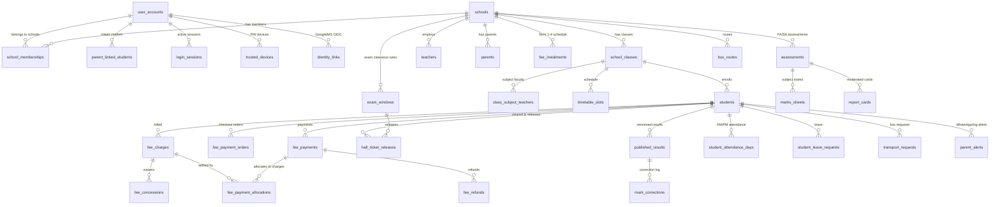

# FutureSchool — PostgreSQL Database Design & Live Inventory

> **Database:** `futureschool` (`PostgreSQL 17`, `localhost:5432`)  
> **Schema Management:** Flyway migrations (`V2`–`V11`) + JPA/Hibernate  
> **Snapshot Captured:** `2026-11-12` (live introspection from `information_schema`, `pg_indexes`, and `futureschool` row counts)

---

## 1. Architecture & Multi-Tenancy Overview

FutureSchool uses a **shared-database, `school_id`-isolated multi-tenant design**:

- **Total tables in live local DB:** **70** (`68` active domain/auth/system tables + `flyway_schema_history` + `1` local-only leftover `admission_enquiries` whose `V12` migration was reverted in commit `1fe8647`).
- **Tenant scoping:** Almost every business table includes `school_id VARCHAR(64) NOT NULL` plus an index on `school_id` or a school-scoped unique key (e.g., `(school_id, receipt_no)`, `(school_id, admission_number)`, `(school_id, teacher_id)`).
- **Cross-school identity:** `user_accounts`, `otp_challenges`, `auth_tickets`, `login_sessions`, `trusted_devices`, `identity_links`, `idp_login_states`, and `parent_linked_students` are global so one parent mobile number (`9876543210`) can hold linked children across multiple schools (`GVS` and `SJM`), while **teachers are constrained to at most one active school** via partial unique index `uk_teacher_one_active_school` on `school_memberships(account_id) WHERE role = 'TEACHER' AND active`.
- **Two-generation schema note:** Migrations `V2`–`V11` introduced cleaner `school_id`-enforced tables (`student_attendance_days`, `homework_tasks`, `marks_sheets`, `complaint_cases`, `bus_routes`, `fee_charges`/`fee_payments`) alongside earlier tables (`attendance_records`, `homework_assignments`, `marks_records`, `complaints_tickets`, `transport_routes`, `fee_transactions`). Both sets remain in the schema.

---

## 2. Entity Relationship Diagram (Core Domain)

---

## 3. Live Database Data Summary (`futureschool`)

### Schools (`schools`: 2 rows)
| `id` | `name` | `board` | `status` | `late_fee_policy` |
|---|---|---|---|---|
| `GVS` | Greenwood Valley High School | `TELANGANA_SSC` | `ACTIVE` | Late fee as per school policy, set by the school Admin. None is applied automatically in this prototype. |
| `SJM` | St. Jude Model High School | `TELANGANA_SSC` | `ACTIVE` | Late fee as per school policy, set by the school Admin. |

### Demo Accounts & Memberships (`user_accounts`: 206, `school_memberships`: 209)
- **Role distribution in `user_accounts`:** `180` `STUDENT`, `16` `TEACHER`, `4` `PARENT`, `3` `ADMIN`, `3` `PRINCIPAL` (`Active`).
- **School breakdown in `school_memberships`:**
  - `GVS`: `180` students, `15` teachers, `4` parents, `3` admins, `2` principals (all active).
  - `SJM`: `2` parents (active), `1` principal (active), `1` active teacher + `1` inactive teacher (`active = false`).
- **Students (`183` rows):**
  - `GVS`: `GVS-10-A` (30), `GVS-10-B` (30), `class-8-a` (30), `class-8-b` (30), `GVS-9-A` (31), `class-9-b` (30), `GVS-6-B` (1).
  - `SJM`: `SJM-4-B` (1).
- **Fee Instalments (`8` rows):** `Term 1` (`2026-06-15`), `Term 2` (`2026-11-15`), `Term 3` (`2027-01-10`), `Term 4` (`2027-02-10`) for both `GVS` and `SJM`.
- **Exam Windows (`2` rows):** `EX-GVS-SA1` (`SA-1`, `2026-11-23`, requires clearance through instalment `2` on `SCHOOL_FEE,TRANSPORT_FEE`) and `EX-SJM-SA1` (`SA-1`, `2026-11-25`, instalment `2` on `SCHOOL_FEE`).
- **Bus Routes (`3` rows on `GVS`):** `Route 2 · Madhapur` (`TS 09 UB 2211`, cap 40, ₹1500/instalment), `Route 4 · Kondapur` (`TS 09 UB 4410`, cap 3, ₹1500), `Route 7 · Gachibowli` (`TS 09 UB 7702`, cap 36, ₹1500).

### Complete Table Row Counts (All 70 Tables)
| Table | Rows | Table | Rows | Table | Rows |
|---|---:|---|---:|---|---:|
| `student_attendance_days` | 702 | `marks_records` | 6 | `academic_years` | 0 |
| `timetable_slots` | 272 | `parents` | 5 | `admission_enquiries` *(reverted)* | 0 |
| `school_memberships` | 209 | `change_requests` | 4 | `alert_opt_outs` | 0 |
| `user_accounts` | 206 | `class_notices` | 4 | `alert_settings` | 0 |
| `students` | 183 | `fee_concessions` | 4 | `attendance_registers` | 0 |
| `login_sessions` | 77 | `bus_routes` | 3 | `book_issue_records` | 0 |
| `auth_tickets` | 71 | `hall_ticket_releases` | 3 | `calendar_events` | 0 |
| `fee_charges` | 67 | `exam_windows` | 2 | `certificate_records` | 0 |
| `attendance_records` | 60 | `parent_alerts` | 2 | `complaints_tickets` | 0 |
| `otp_challenges` | 53 | `published_results` | 2 | `fee_refunds` | 0 |
| `fee_payment_allocations` | 37 | `schools` | 2 | `homework_assignments` | 0 |
| `class_subject_teachers` | 32 | `student_leave_requests` | 2 | `identity_links` | 0 |
| `audit_events` | 18 | `teacher_leave_requests` | 2 | `idp_login_states` | 0 |
| `teachers` | 17 | `assessments` | 1 | `library_books` | 0 |
| `fee_payments` | 16 | `complaint_cases` | 1 | `parent_teacher_meetings` | 0 |
| `marks_sheets` | 16 | `consent_forms` | 1 | `pickup_passes` | 0 |
| `trusted_devices` | 15 | `consent_responses` | 1 | `quizzes` | 0 |
| `flyway_schema_history` | 12 | `fee_transactions` | 1 | `report_cards` | 0 |
| `fee_instalments` | 8 | `mark_corrections` | 1 | `school_notices` | 0 |
| `parent_linked_students` | 8 | `message_threads` | 1 | `school_settings` | 0 |
| `school_classes` | 8 | `parent_meetings` | 1 | `staff_attendance_records` | 0 |
| `fee_payment_orders` | 6 | `transport_requests` | 1 | `staff_invitations` | 0 |
| `homework_tasks` | 6 | | | `study_materials` | 0 |
| | | | | `subject_allocations` | 0 |
| | | | | `transport_routes` | 0 |

---

## 4. Flyway Migration History

| Rank | Version | Description | Purpose |
|---:|---|---|---|
| 1 | `1` | `<< Flyway Baseline >>` | Baseline existing DB |
| 2 | `2` | `school id multitenancy` | Adds `school_id` across tables, backfills `GVS`, creates per-school unique keys |
| 3 | `3` | `backfill signin mobiles` | Copies unique parent/teacher mobile numbers onto `user_accounts` |
| 4 | `4` | `full schema` | Full idempotent baseline schema (`2,298` lines) |
| 5 | `5` | `teacher one school` | Partial unique index `uk_teacher_one_active_school` |
| 6 | `6` | `teacher pin` | Adds `pin_hash`, `pin_failed_attempts`, `pin_updated_at` on `school_memberships` |
| 7 | `7` | `trusted devices` | Creates `trusted_devices` for PIN-only sign-in |
| 8 | `8` | `parent pin` | Adds account-level `pin_hash` / lock counters on `user_accounts` + `kind` on `trusted_devices` |
| 9 | `9` | `microsoft google sign in` | Creates `identity_links`, `idp_login_states`, and pending OIDC columns on `auth_tickets` |
| 10 | `10` | `parent whatsapp alerts` | Creates `parent_alerts`, `alert_settings`, `alert_opt_outs` |
| 11 | `11` | `razorpay orders` | Adds `provider`, `provider_order_id`, `step_up_verified`, `payment_id` on `fee_payment_orders` |
| 12 *(reverted in code)* | `12` | `admission enquiries` | Present in local DB history only; removed from repo in `1fe8647` |

---

## 5. Complete Table-by-Table Schema Reference

### Domain A — Tenancy, Identity, Auth & Security

#### `schools` *(Global tenant registry, 2 rows)*
- **PK:** `id` (`varchar(64)`)
- **Columns:** `id` (`varchar(64)` NOT NULL), `name` (`varchar(200)` NOT NULL), `board` (`varchar(64)` NOT NULL), `status` (`varchar(32)` NOT NULL), `created_at` (`timestamp`), `late_fee_policy` (`varchar(300)`)

#### `user_accounts` *(Global login identities, 206 rows)*
- **PK:** `id` (`varchar(64)`)
- **Indexes/Unique:** `idx_user_login_id` UNIQUE(`login_id`), `idx_user_email` (`email`), `idx_user_mobile` (`mobile`)
- **Columns:** `id` (`varchar(64)` NOT NULL), `active` (`boolean` NOT NULL), `created_at` (`timestamp`), `email` (`varchar(128)`), `login_id` (`varchar(64)` NOT NULL), `name` (`varchar(128)` NOT NULL), `password` (`varchar(255)` NOT NULL), `role` (`varchar(32)` NOT NULL), `status` (`varchar(32)` NOT NULL), `student_id` (`varchar(64)`), `teacher_id` (`varchar(64)`), `updated_at` (`timestamp`), `mobile` (`varchar(16)`), `pin_hash` (`varchar(100)`), `pin_failed_attempts` (`integer` NOT NULL), `pin_updated_at` (`bigint`)

#### `school_memberships` *(User ↔ School ↔ Role + Teacher PIN, 209 rows)*
- **PK:** `id` (`varchar(64)`)
- **Indexes/Unique:** `uk_membership_account_school_role` UNIQUE(`account_id`, `school_id`, `role`), `uk_teacher_one_active_school` UNIQUE(`account_id`) `WHERE role = 'TEACHER' AND active`, `idx_membership_account` (`account_id`)
- **Columns:** `id` (`varchar(64)` NOT NULL), `account_id` (`varchar(64)` NOT NULL), `school_id` (`varchar(64)` NOT NULL), `role` (`varchar(32)` NOT NULL), `title` (`varchar(128)`), `active` (`boolean` NOT NULL), `created_at` (`timestamp`), `permissions` (`varchar(255)`), `pin_hash` (`varchar(100)`), `pin_failed_attempts` (`integer` NOT NULL), `pin_updated_at` (`bigint`)

#### `parent_linked_students` *(8 rows)*
- **FK:** `user_account_id` → `user_accounts(id)`
- **Columns:** `user_account_id` (`varchar(64)` NOT NULL), `linked_student_id` (`varchar(255)`)

#### `otp_challenges` *(53 rows)*
- **PK:** `id` (`varchar(64)`) · **Index:** `idx_otp_destination_created` (`destination`, `created_at`)
- **Columns:** `id` (`varchar(64)` NOT NULL), `attempts_left` (`integer` NOT NULL), `bound_to` (`varchar(64)`), `channel` (`varchar(8)` NOT NULL), `code_hash` (`varchar(128)` NOT NULL), `consumed` (`boolean` NOT NULL), `created_at` (`bigint` NOT NULL), `destination` (`varchar(160)` NOT NULL), `expires_at` (`bigint` NOT NULL), `last_sent_at` (`bigint` NOT NULL), `purpose` (`varchar(40)` NOT NULL), `resends` (`integer` NOT NULL)

#### `auth_tickets` *(71 rows)*
- **PK:** `id` (`varchar(64)`)
- **Columns:** `id` (`varchar(64)` NOT NULL), `account_id` (`varchar(64)` NOT NULL), `expires_at` (`bigint` NOT NULL), `kind` (`varchar(32)` NOT NULL), `methods` (`varchar(128)` NOT NULL), `used` (`boolean` NOT NULL), `invite_token` (`varchar(64)`), `pending_password_hash` (`varchar(100)`), `pending_idp_provider` (`varchar(16)`), `pending_idp_subject` (`varchar(200)`), `pending_idp_email` (`varchar(200)`)

#### `login_sessions` *(77 rows)*
- **PK:** `id` (`varchar(64)`) · **Index:** `idx_session_account` (`account_id`)
- **Columns:** `id` (`varchar(64)` NOT NULL), `account_id` (`varchar(64)` NOT NULL), `contact` (`varchar(200)`), `expires_at` (`bigint` NOT NULL), `issued_at` (`bigint` NOT NULL), `membership_id` (`varchar(64)` NOT NULL), `methods` (`varchar(128)` NOT NULL), `revoked` (`boolean` NOT NULL), `school_id` (`varchar(64)` NOT NULL), `student_id` (`varchar(64)`)

#### `trusted_devices` *(15 rows)*
- **PK:** `id` (`varchar(64)`) · **Unique:** `uk_trusted_device_token` (`token_hash`) · **Index:** `idx_trusted_device_account` (`account_id`)
- **Columns:** `id` (`varchar(64)` NOT NULL), `token_hash` (`varchar(64)` NOT NULL), `account_id` (`varchar(64)` NOT NULL), `membership_id` (`varchar(64)` NOT NULL), `label` (`varchar(120)`), `created_at` (`bigint` NOT NULL), `last_used_at` (`bigint`), `expires_at` (`bigint` NOT NULL), `revoked` (`boolean` NOT NULL), `kind` (`varchar(16)` NOT NULL)

#### `staff_invitations` *(0 rows)*
- **PK:** `token` (`varchar(64)`)
- **Columns:** `token` (`varchar(64)` NOT NULL), `account_id` (`varchar(64)` NOT NULL), `email` (`varchar(160)` NOT NULL), `expires_at` (`bigint` NOT NULL), `invited_by` (`varchar(64)` NOT NULL), `membership_id` (`varchar(64)` NOT NULL), `role` (`varchar(16)` NOT NULL), `school_id` (`varchar(64)` NOT NULL), `used_at` (`bigint`)

#### `identity_links` *(0 rows)*
- **PK:** `id` (`varchar(64)`) · **Unique:** `uk_identity_link_subject` (`provider`, `subject`) · **Index:** `idx_identity_link_account` (`account_id`)
- **Columns:** `id` (`varchar(64)` NOT NULL), `provider` (`varchar(16)` NOT NULL), `subject` (`varchar(200)` NOT NULL), `account_id` (`varchar(64)` NOT NULL), `email` (`varchar(200)`), `created_at` (`bigint` NOT NULL)

#### `idp_login_states` *(0 rows)*
- **PK:** `state` (`varchar(64)`)
- **Columns:** `state` (`varchar(64)` NOT NULL), `provider` (`varchar(16)` NOT NULL), `nonce` (`varchar(64)` NOT NULL), `code_verifier` (`varchar(128)` NOT NULL), `invite_token` (`varchar(64)`), `expires_at` (`bigint` NOT NULL), `used` (`boolean` NOT NULL)

#### `audit_events` *(Append-only security & governance audit log, 18 rows)*
- **PK:** `id` (`varchar(200)`) · **Index:** `idx_audit_at` (`at`)
- **Columns:** `id` (`varchar(200)` NOT NULL), `school_id` (`varchar(64)` NOT NULL), `action` (`varchar(64)` NOT NULL), `actor_id` (`varchar(64)` NOT NULL), `actor_role` (`varchar(32)` NOT NULL), `at` (`varchar(40)` NOT NULL), `details` (`varchar(1000)` NOT NULL), `reason` (`varchar(500)`), `target_id` (`varchar(160)` NOT NULL)

---

### Domain B — School Settings, Directory, Classes & Timetables

#### `school_settings` *(0 rows)*
- **PK:** `id` (`varchar(64)`) · **Index:** `idx_school_settings_school` (`school_id`)
- **Columns:** `id` (`varchar(64)` NOT NULL), `address` (`varchar(255)`), `affiliation_number` (`varchar(64)`), `current_academic_year` (`varchar(32)`), `email` (`varchar(128)`), `phone` (`varchar(32)`), `school_code` (`varchar(32)`), `school_name` (`varchar(128)` NOT NULL), `website` (`varchar(128)`), `school_id` (`varchar(64)` NOT NULL)

#### `academic_years` *(0 rows)*
- **PK:** `id` (`varchar(64)`) · **Index:** `idx_academic_years_school` (`school_id`)
- **Columns:** `id` (`varchar(64)` NOT NULL), `end_date` (`date` NOT NULL), `is_current` (`boolean` NOT NULL), `name` (`varchar(64)` NOT NULL), `start_date` (`date` NOT NULL), `school_id` (`varchar(64)` NOT NULL)

#### `school_classes` *(8 rows)*
- **PK:** `id` (`varchar(64)`) · **Unique:** `uk_class_school_section` (`school_id`, `name`, `section`) · **Index:** `idx_school_classes_school` (`school_id`)
- **Columns:** `id` (`varchar(64)` NOT NULL), `active` (`boolean` NOT NULL), `class_teacher_id` (`varchar(64)`), `class_teacher_name` (`varchar(128)`), `grade_number` (`integer`), `name` (`varchar(64)` NOT NULL), `school_level` (`varchar(32)`), `section` (`varchar(16)` NOT NULL), `school_id` (`varchar(64)` NOT NULL)

#### `teachers` *(17 rows)*
- **PK:** `id` (`varchar(64)`) · **Unique:** `uk_teacher_school_tid` (`school_id`, `teacher_id`) · **Index:** `idx_teachers_school` (`school_id`)
- **Columns:** `id` (`varchar(64)` NOT NULL), `active` (`boolean` NOT NULL), `created_at` (`timestamp`), `designation` (`varchar(64)`), `email` (`varchar(128)`), `name` (`varchar(128)` NOT NULL), `phone` (`varchar(32)`), `primary_subject` (`varchar(64)`), `qualification` (`varchar(128)`), `teacher_id` (`varchar(64)` NOT NULL), `school_id` (`varchar(64)` NOT NULL)

#### `parents` *(5 rows)*
- **PK:** `id` (`varchar(64)`) · **Unique:** `uk_parent_school_login` (`school_id`, `login_id`) · **Index:** `idx_parents_school` (`school_id`)
- **Columns:** `id` (`varchar(64)` NOT NULL), `address` (`varchar(255)`), `created_at` (`timestamp`), `email` (`varchar(128)`), `login_id` (`varchar(64)` NOT NULL), `mobile` (`varchar(32)`), `name` (`varchar(128)` NOT NULL), `occupation` (`varchar(128)`), `school_id` (`varchar(64)` NOT NULL)

#### `students` *(Core student + UDISE+ dossier, 183 rows)*
- **PK:** `id` (`varchar(64)`) · **Unique:** `uk_student_school_adm` (`school_id`, `admission_number`) · **Indexes:** `idx_students_school` (`school_id`), `idx_student_class_id` (`class_id`), `idx_student_parent_account_id` (`parent_account_id`)
- **Columns:** `id` (`varchar(64)` NOT NULL), `address` (`varchar(255)`), `admission_number` (`varchar(64)` NOT NULL), `class_id` (`varchar(64)` NOT NULL), `class_name` (`varchar(64)` NOT NULL), `created_at` (`timestamp`), `destination_school` (`varchar(255)`), `dob` (`varchar(32)`), `exit_date` (`varchar(32)`), `exit_reason` (`varchar(255)`), `fee_balance` (`double precision`), `gender` (`varchar(16)`), `hall_ticket_approved` (`boolean`), `hall_ticket_released` (`boolean`), `name` (`varchar(128)` NOT NULL), `parent_account_id` (`varchar(64)`), `parent_email` (`varchar(128)`), `parent_mobile` (`varchar(32)`), `parent_name` (`varchar(128)`), `roll` (`varchar(16)` NOT NULL), `section` (`varchar(16)` NOT NULL), `status` (`varchar(32)` NOT NULL), `transport_route_id` (`varchar(64)`), `updated_at` (`timestamp`), `aadhaar_number` (`varchar(20)`), `apaar_id` (`varchar(32)`), `blood_group` (`varchar(16)`), `caste_category` (`varchar(32)`), `district` (`varchar(64)`), `father_aadhaar` (`varchar(20)`), `father_mobile` (`varchar(32)`), `father_name` (`varchar(128)`), `father_occupation` (`varchar(128)`), `mandal` (`varchar(64)`), `medium_of_instruction` (`varchar(32)`), `mother_aadhaar` (`varchar(20)`), `mother_mobile` (`varchar(32)`), `mother_name` (`varchar(128)`), `mother_occupation` (`varchar(128)`), `mother_tongue` (`varchar(32)`), `pincode` (`varchar(16)`), `previous_school` (`varchar(255)`), `religion` (`varchar(32)`), `second_language` (`varchar(32)`), `sub_caste` (`varchar(64)`), `tc_number` (`varchar(64)`), `school_id` (`varchar(64)` NOT NULL), `transport_stop` (`varchar(128)`)

#### `class_subject_teachers` *(32 rows)*
- **PK:** `id` (`varchar(200)`) · **Indexes:** `idx_cst_class` (`class_id`), `idx_cst_staff` (`staff_id`)
- **Columns:** `id` (`varchar(200)` NOT NULL), `school_id` (`varchar(64)` NOT NULL), `class_id` (`varchar(64)` NOT NULL), `staff_id` (`varchar(64)` NOT NULL), `staff_name` (`varchar(128)` NOT NULL), `subject` (`varchar(64)` NOT NULL)

#### `subject_allocations` *(0 rows)*
- **PK:** `id` (`varchar(64)`) · **Indexes:** `idx_subject_allocations_school` (`school_id`), `idx_alloc_class` (`class_id`), `idx_alloc_teacher` (`teacher_id`)
- **Columns:** `id` (`varchar(64)` NOT NULL), `academic_year_id` (`varchar(32)`), `active` (`boolean` NOT NULL), `class_id` (`varchar(64)` NOT NULL), `created_at` (`timestamp`), `role` (`varchar(32)`), `subject` (`varchar(64)` NOT NULL), `teacher_id` (`varchar(64)` NOT NULL), `teacher_name` (`varchar(128)`), `updated_at` (`timestamp`), `school_id` (`varchar(64)` NOT NULL)

#### `timetable_slots` *(272 rows)*
- **PK:** `id` (`varchar(64)`) · **Indexes:** `idx_timetable_slots_school` (`school_id`), `idx_tt_class_day` (`class_id`, `day_of_week`), `idx_tt_teacher_day` (`teacher_id`, `day_of_week`)
- **Columns:** `id` (`varchar(64)` NOT NULL), `class_id` (`varchar(64)` NOT NULL), `day_of_week` (`varchar(16)` NOT NULL), `end_time` (`varchar(16)` NOT NULL), `period_number` (`integer` NOT NULL), `room_number` (`varchar(32)`), `start_time` (`varchar(16)` NOT NULL), `subject` (`varchar(64)` NOT NULL), `teacher_id` (`varchar(64)`), `teacher_name` (`varchar(128)`), `school_id` (`varchar(64)` NOT NULL)

---

### Domain C — Attendance & Leave Management

#### `student_attendance_days` *(Active AM/PM attendance store, 702 rows)*
- **PK:** `id` (`varchar(96)`) · **Unique:** `uk_att_day_school_student_date` (`school_id`, `student_id`, `attendance_date`)
- **Columns:** `id` (`varchar(96)` NOT NULL), `school_id` (`varchar(64)` NOT NULL), `afternoon` (`varchar(1)` NOT NULL), `attendance_date` (`varchar(10)` NOT NULL), `morning` (`varchar(1)` NOT NULL), `student_id` (`varchar(64)` NOT NULL)

#### `attendance_registers` *(Daily class register snapshots + change history JSON, 0 rows)*
- **PK:** `id` (`varchar(200)`)
- **Columns:** `id` (`varchar(200)` NOT NULL), `school_id` (`varchar(64)` NOT NULL), `class_id` (`varchar(64)` NOT NULL), `register_date` (`varchar(10)` NOT NULL), `history_json` (`varchar(20000)` NOT NULL), `marks_json` (`varchar(20000)` NOT NULL), `saved_at` (`varchar(40)` NOT NULL), `saved_by` (`varchar(64)` NOT NULL), `session` (`varchar(16)` NOT NULL)

#### `attendance_records` *(60 rows)*
- **PK:** `id` (`varchar(64)`) · **Indexes:** `idx_attendance_records_school` (`school_id`), `idx_att_class_date` (`class_id`, `attendance_date`), `idx_att_student` (`student_id`)
- **Columns:** `id` (`varchar(64)` NOT NULL), `attendance_date` (`date` NOT NULL), `class_id` (`varchar(64)` NOT NULL), `created_at` (`timestamp`), `recorded_by` (`varchar(64)`), `remarks` (`varchar(255)`), `roll` (`varchar(16)`), `status` (`varchar(16)` NOT NULL), `student_id` (`varchar(64)` NOT NULL), `student_name` (`varchar(128)` NOT NULL), `school_id` (`varchar(64)` NOT NULL)

#### `staff_attendance_records` *(0 rows)*
- **PK:** `id` (`varchar(64)`) · **Indexes:** `idx_staff_attendance_records_school` (`school_id`), `idx_staff_att_date` (`attendance_date`), `idx_staff_att_teacher` (`teacher_id`)
- **Columns:** `id` (`varchar(64)` NOT NULL), `attendance_date` (`date` NOT NULL), `check_in_time` (`varchar(16)`), `check_out_time` (`varchar(16)`), `created_at` (`timestamp`), `designation` (`varchar(64)`), `remarks` (`varchar(255)`), `status` (`varchar(32)` NOT NULL), `teacher_id` (`varchar(64)` NOT NULL), `teacher_name` (`varchar(128)` NOT NULL), `school_id` (`varchar(64)` NOT NULL)

#### `student_leave_requests` *(2 rows)*
- **PK:** `id` (`varchar(96)`) · **Indexes:** `idx_sleave_class` (`class_id`), `idx_sleave_student` (`student_id`)
- **Columns:** `id` (`varchar(96)` NOT NULL), `school_id` (`varchar(64)` NOT NULL), `class_id` (`varchar(64)` NOT NULL), `decided_at` (`varchar(40)`), `decided_by` (`varchar(64)`), `decided_by_name` (`varchar(128)`), `decision_note` (`varchar(300)`), `from_date` (`varchar(10)` NOT NULL), `kind` (`varchar(32)` NOT NULL), `reason` (`varchar(500)` NOT NULL), `requested_at` (`varchar(40)` NOT NULL), `requested_by_guardian_id` (`varchar(64)` NOT NULL), `status` (`varchar(16)` NOT NULL), `student_id` (`varchar(64)` NOT NULL), `to_date` (`varchar(10)` NOT NULL)

#### `teacher_leave_requests` *(2 rows)*
- **PK:** `id` (`varchar(96)`) · **Index:** `idx_tleave_staff` (`staff_id`)
- **Columns:** `id` (`varchar(96)` NOT NULL), `school_id` (`varchar(64)` NOT NULL), `arranged_by` (`varchar(64)`), `decided_at` (`varchar(40)`), `decided_by` (`varchar(64)`), `decision_note` (`varchar(300)`), `from_date` (`varchar(10)` NOT NULL), `kind` (`varchar(16)` NOT NULL), `reason` (`varchar(500)` NOT NULL), `staff_id` (`varchar(64)` NOT NULL), `staff_name` (`varchar(128)` NOT NULL), `status` (`varchar(16)` NOT NULL), `substitution_json` (`varchar(20000)` NOT NULL), `to_date` (`varchar(10)` NOT NULL)

---

### Domain D — Assessments, Marks, Report Cards & Hall Tickets

#### `assessments` *(1 row)*
- **PK:** `id` (`varchar(200)`)
- **Columns:** `id` (`varchar(200)` NOT NULL), `school_id` (`varchar(64)` NOT NULL), `academic_year` (`varchar(16)` NOT NULL), `grades_csv` (`varchar(64)` NOT NULL), `max_external` (`integer` NOT NULL), `max_internal` (`integer` NOT NULL), `name` (`varchar(32)` NOT NULL), `pass_percent` (`integer` NOT NULL), `second_language_pass_percent` (`integer` NOT NULL), `second_language_subjects_csv` (`varchar(200)` NOT NULL), `status` (`varchar(16)` NOT NULL)

#### `marks_sheets` *(16 rows)*
- **PK:** `id` (`varchar(200)`) · **Index:** `idx_sheet_class` (`assessment_id`, `class_id`)
- **Columns:** `id` (`varchar(200)` NOT NULL), `school_id` (`varchar(64)` NOT NULL), `assessment_id` (`varchar(64)` NOT NULL), `class_id` (`varchar(64)` NOT NULL), `log_json` (`varchar(20000)` NOT NULL), `return_reason` (`varchar(500)`), `rows_json` (`varchar(20000)` NOT NULL), `status` (`varchar(16)` NOT NULL), `subject` (`varchar(64)` NOT NULL), `teacher_staff_id` (`varchar(64)` NOT NULL)

#### `marks_records` *(6 rows)*
- **PK:** `id` (`varchar(64)`) · **Indexes:** `idx_marks_records_school` (`school_id`), `idx_marks_class_exam` (`class_id`, `exam`, `subject`), `idx_marks_student` (`student_id`)
- **Columns:** `id` (`varchar(64)` NOT NULL), `class_id` (`varchar(64)` NOT NULL), `created_at` (`timestamp`), `entered_by_teacher_id` (`varchar(64)`), `exam` (`varchar(64)` NOT NULL), `grade` (`varchar(8)`), `maximum_marks` (`double precision` NOT NULL), `percentage` (`double precision`), `remarks` (`varchar(255)`), `score` (`double precision` NOT NULL), `status` (`varchar(32)` NOT NULL), `student_id` (`varchar(64)` NOT NULL), `student_name` (`varchar(128)` NOT NULL), `subject` (`varchar(64)` NOT NULL), `updated_at` (`timestamp`), `verified_by_user_id` (`varchar(64)`), `school_id` (`varchar(64)` NOT NULL)

#### `report_cards` *(0 rows)*
- **PK:** `id` (`varchar(200)`) · **Index:** `idx_card_class` (`assessment_id`, `class_id`)
- **Columns:** `id` (`varchar(200)` NOT NULL), `school_id` (`varchar(64)` NOT NULL), `assessment_id` (`varchar(64)` NOT NULL), `class_id` (`varchar(64)` NOT NULL), `class_teacher_remark` (`varchar(300)` NOT NULL), `log_json` (`varchar(20000)` NOT NULL), `principal_note` (`varchar(500)`), `status` (`varchar(16)` NOT NULL), `student_id` (`varchar(64)` NOT NULL), `subjects_json` (`varchar(20000)` NOT NULL)

#### `published_results` *(2 rows)*
- **PK:** `id` (`varchar(96)`) · **Index:** `idx_result_student` (`student_id`)
- **Columns:** `id` (`varchar(96)` NOT NULL), `school_id` (`varchar(64)` NOT NULL), `class_teacher_remark` (`varchar(500)`), `exam_name` (`varchar(32)` NOT NULL), `published_on` (`varchar(10)` NOT NULL), `status` (`varchar(16)` NOT NULL), `student_id` (`varchar(64)` NOT NULL), `subjects_json` (`varchar(4000)` NOT NULL), `version` (`integer` NOT NULL)

#### `mark_corrections` *(1 row)*
- **PK:** `id` (`varchar(96)`) · **Index:** `idx_correction_class` (`class_id`)
- **Columns:** `id` (`varchar(96)` NOT NULL), `school_id` (`varchar(64)` NOT NULL), `class_id` (`varchar(64)` NOT NULL), `exam_name` (`varchar(32)` NOT NULL), `field` (`varchar(16)` NOT NULL), `from_value` (`varchar(8)` NOT NULL), `log_json` (`varchar(20000)` NOT NULL), `raised_by` (`varchar(64)` NOT NULL), `reason` (`varchar(500)` NOT NULL), `result_id` (`varchar(200)` NOT NULL), `status` (`varchar(16)` NOT NULL), `student_id` (`varchar(64)` NOT NULL), `subject` (`varchar(64)` NOT NULL), `to_value` (`varchar(8)` NOT NULL)

#### `exam_windows` *(2 rows)*
- **PK:** `id` (`varchar(96)`)
- **Columns:** `id` (`varchar(96)` NOT NULL), `school_id` (`varchar(64)` NOT NULL), `clearance_categories_csv` (`varchar(200)` NOT NULL), `clearance_upto_instalment` (`integer` NOT NULL), `grades_csv` (`varchar(64)` NOT NULL), `name` (`varchar(32)` NOT NULL), `starts_on` (`varchar(10)` NOT NULL)

#### `hall_ticket_releases` *(3 rows)*
- **PK:** `id` (`varchar(96)`) · **Unique:** `uk_release_school_exam_student` (`school_id`, `exam_id`, `student_id`)
- **Columns:** `id` (`varchar(96)` NOT NULL), `school_id` (`varchar(64)` NOT NULL), `exam_id` (`varchar(64)` NOT NULL), `override_at` (`varchar(40)`), `override_by` (`varchar(64)`), `override_reason` (`varchar(300)`), `released_at` (`varchar(40)` NOT NULL), `released_by` (`varchar(64)` NOT NULL), `student_id` (`varchar(64)` NOT NULL)

---

### Domain E — Fees, Concessions & Razorpay Payments

#### `fee_instalments` *(Term 1–4 schedules per school, 8 rows)*
- **PK:** `id` (`varchar(96)`)
- **Columns:** `id` (`varchar(96)` NOT NULL), `school_id` (`varchar(64)` NOT NULL), `due_on` (`varchar(10)` NOT NULL), `label` (`varchar(64)` NOT NULL), `number` (`integer` NOT NULL)

#### `fee_charges` *(67 rows)*
- **PK:** `id` (`varchar(96)`) · **Index:** `idx_charge_student` (`student_id`)
- **Columns:** `id` (`varchar(96)` NOT NULL), `school_id` (`varchar(64)` NOT NULL), `amount` (`bigint` NOT NULL), `category` (`varchar(32)` NOT NULL), `due_on` (`varchar(10)` NOT NULL), `instalment` (`integer` NOT NULL), `label` (`varchar(128)` NOT NULL), `student_id` (`varchar(64)` NOT NULL)

#### `fee_concessions` *(4 rows)*
- **PK:** `id` (`varchar(96)`) · **Index:** `idx_concession_charge` (`charge_id`)
- **Columns:** `id` (`varchar(96)` NOT NULL), `school_id` (`varchar(64)` NOT NULL), `amount` (`bigint` NOT NULL), `approved_on` (`varchar(10)` NOT NULL), `charge_id` (`varchar(64)` NOT NULL), `kind` (`varchar(32)` NOT NULL)

#### `fee_payment_orders` *(Single-use 15-min checkout / Razorpay orders, 6 rows)*
- **PK:** `id` (`varchar(96)`) · **Index:** `idx_order_provider_id` (`provider_order_id`)
- **Columns:** `id` (`varchar(96)` NOT NULL), `school_id` (`varchar(64)` NOT NULL), `allocations_json` (`varchar(4000)` NOT NULL), `amount` (`bigint` NOT NULL), `consumed` (`boolean` NOT NULL), `expires_at` (`bigint` NOT NULL), `session_id` (`varchar(64)` NOT NULL), `student_id` (`varchar(64)` NOT NULL), `provider` (`varchar(24)` NOT NULL), `provider_order_id` (`varchar(128)`), `step_up_verified` (`boolean` NOT NULL), `payment_id` (`varchar(96)`)

#### `fee_payments` *(Immutable payment receipts, 16 rows)*
- **PK:** `id` (`varchar(96)`) · **Unique:** `uk_payment_school_receipt` (`school_id`, `receipt_no`) · **Index:** `idx_payment_student` (`student_id`)
- **Columns:** `id` (`varchar(96)` NOT NULL), `school_id` (`varchar(64)` NOT NULL), `amount` (`bigint` NOT NULL), `method` (`varchar(32)` NOT NULL), `is_mock` (`boolean` NOT NULL), `paid_at` (`varchar(40)` NOT NULL), `paid_by_guardian_id` (`varchar(64)`), `provider_ref` (`varchar(128)` NOT NULL), `receipt_no` (`varchar(64)` NOT NULL), `recorded_by_staff_id` (`varchar(64)`), `student_id` (`varchar(64)` NOT NULL)

#### `fee_payment_allocations` *(Maps each payment to settled `fee_charges`, 37 rows)*
- **FK:** `payment_id` → `fee_payments(id)`
- **Columns:** `payment_id` (`varchar(96)` NOT NULL), `amount` (`bigint` NOT NULL), `charge_id` (`varchar(96)` NOT NULL)

#### `fee_refunds` *(0 rows)*
- **PK:** `id` (`varchar(96)`)
- **Columns:** `id` (`varchar(96)` NOT NULL), `school_id` (`varchar(64)` NOT NULL), `amount` (`bigint` NOT NULL), `created_at` (`varchar(40)` NOT NULL), `payment_id` (`varchar(64)` NOT NULL), `reason` (`varchar(300)` NOT NULL), `status` (`varchar(16)` NOT NULL)

#### `fee_transactions` *(1 row)*
- **PK:** `id` (`varchar(64)`) · **Unique:** `uk_fee_school_receipt` (`school_id`, `receipt_number`) · **Indexes:** `idx_fee_transactions_school` (`school_id`), `idx_fee_student` (`student_id`)
- **Columns:** `id` (`varchar(64)` NOT NULL), `amount` (`double precision` NOT NULL), `class_id` (`varchar(64)` NOT NULL), `collected_by` (`varchar(64)`), `created_at` (`timestamp`), `fee_head` (`varchar(64)` NOT NULL), `payment_date` (`date` NOT NULL), `payment_method` (`varchar(32)` NOT NULL), `receipt_number` (`varchar(64)` NOT NULL), `remarks` (`varchar(255)`), `student_id` (`varchar(64)` NOT NULL), `student_name` (`varchar(128)` NOT NULL), `transaction_reference` (`varchar(128)`), `school_id` (`varchar(64)` NOT NULL)

---

### Domain F — Homework, Materials, Quizzes & Library

#### `homework_tasks` *(6 rows)*
- **PK:** `id` (`varchar(96)`) · **Index:** `idx_hw_task_class` (`class_id`)
- **Columns:** `id` (`varchar(96)` NOT NULL), `school_id` (`varchar(64)` NOT NULL), `assigned_on` (`varchar(10)` NOT NULL), `class_id` (`varchar(64)` NOT NULL), `due_on` (`varchar(10)` NOT NULL), `instructions` (`varchar(1000)` NOT NULL), `status_json` (`varchar(20000)` NOT NULL), `subject` (`varchar(64)` NOT NULL), `submission_type` (`varchar(16)` NOT NULL), `teacher_name` (`varchar(128)` NOT NULL), `teacher_staff_id` (`varchar(64)` NOT NULL), `title` (`varchar(200)` NOT NULL)

#### `homework_assignments` *(0 rows)*
- **PK:** `id` (`varchar(64)`) · **Indexes:** `idx_homework_assignments_school` (`school_id`), `idx_hw_class` (`class_id`)
- **Columns:** `id` (`varchar(64)` NOT NULL), `assigned_date` (`date` NOT NULL), `attachment_url` (`varchar(255)`), `class_id` (`varchar(64)` NOT NULL), `created_at` (`timestamp`), `description` (`text`), `due_date` (`date` NOT NULL), `status` (`varchar(32)`), `subject` (`varchar(64)` NOT NULL), `teacher_id` (`varchar(64)`), `teacher_name` (`varchar(128)`), `title` (`varchar(255)` NOT NULL), `school_id` (`varchar(64)` NOT NULL)

#### `study_materials` *(0 rows)*
- **PK:** `id` (`varchar(64)`) · **Indexes:** `idx_study_materials_school` (`school_id`), `idx_mat_class_subject` (`class_id`, `subject`)
- **Columns:** `id` (`varchar(64)` NOT NULL), `class_id` (`varchar(64)` NOT NULL), `description` (`text`), `file_url` (`varchar(255)`), `material_type` (`varchar(32)`), `subject` (`varchar(64)` NOT NULL), `title` (`varchar(255)` NOT NULL), `uploaded_at` (`timestamp`), `uploaded_by` (`varchar(128)`), `school_id` (`varchar(64)` NOT NULL)

#### `quizzes` *(0 rows)*
- **PK:** `id` (`varchar(64)`) · **Index:** `idx_quizzes_school` (`school_id`)
- **Columns:** `id` (`varchar(64)` NOT NULL), `active` (`boolean` NOT NULL), `class_id` (`varchar(64)` NOT NULL), `created_at` (`timestamp`), `created_by` (`varchar(128)`), `duration_minutes` (`integer` NOT NULL), `questions_data` (`text`), `subject` (`varchar(64)` NOT NULL), `title` (`varchar(255)` NOT NULL), `total_marks` (`integer` NOT NULL), `school_id` (`varchar(64)` NOT NULL)

#### `library_books` *(0 rows)*
- **PK:** `id` (`varchar(64)`) · **Index:** `idx_library_books_school` (`school_id`)
- **Columns:** `id` (`varchar(64)` NOT NULL), `author` (`varchar(128)` NOT NULL), `available_copies` (`integer` NOT NULL), `category` (`varchar(64)`), `isbn` (`varchar(64)`), `shelf_location` (`varchar(32)`), `title` (`varchar(255)` NOT NULL), `total_copies` (`integer` NOT NULL), `school_id` (`varchar(64)` NOT NULL)

#### `book_issue_records` *(0 rows)*
- **PK:** `id` (`varchar(64)`) · **Indexes:** `idx_book_issue_records_school` (`school_id`), `idx_issue_book` (`book_id`), `idx_issue_student` (`student_id`)
- **Columns:** `id` (`varchar(64)` NOT NULL), `book_id` (`varchar(64)` NOT NULL), `book_title` (`varchar(255)` NOT NULL), `due_date` (`date` NOT NULL), `fine_amount` (`double precision`), `issue_date` (`date` NOT NULL), `return_date` (`date`), `status` (`varchar(32)` NOT NULL), `student_id` (`varchar(64)` NOT NULL), `student_name` (`varchar(128)` NOT NULL), `school_id` (`varchar(64)` NOT NULL)

---

### Domain G — Communication, Alerts, Transport, Gate Security & Governance

#### `parent_alerts` *(WhatsApp/log outbound alert queue, 2 rows)*
- **PK:** `id` (`varchar(64)`) · **Unique:** `uk_alert_school_dedupe` (`school_id`, `dedupe_key`) · **Index:** `idx_alert_status` (`status`, `not_before`)
- **Columns:** `id` (`varchar(64)` NOT NULL), `school_id` (`varchar(64)` NOT NULL), `kind` (`varchar(24)` NOT NULL), `student_id` (`varchar(64)` NOT NULL), `student_name` (`varchar(128)` NOT NULL), `recipient_mobile` (`varchar(16)`), `channel` (`varchar(16)` NOT NULL), `params_json` (`varchar(1000)` NOT NULL), `preview` (`varchar(1000)` NOT NULL), `status` (`varchar(16)` NOT NULL), `attempts` (`integer` NOT NULL), `not_before` (`bigint` NOT NULL), `provider_ref` (`varchar(128)`), `error` (`varchar(300)`), `dedupe_key` (`varchar(200)` NOT NULL), `created_by` (`varchar(64)` NOT NULL), `created_at` (`varchar(40)` NOT NULL), `sent_at` (`varchar(40)`)

#### `alert_settings` *(0 rows)*
- **PK:** `id` (`varchar(80)`)
- **Columns:** `id` (`varchar(80)` NOT NULL), `school_id` (`varchar(64)` NOT NULL), `absence_alerts` (`boolean` NOT NULL), `fee_reminders` (`boolean` NOT NULL), `updated_by` (`varchar(64)`), `updated_at` (`varchar(40)`)

#### `alert_opt_outs` *(0 rows)*
- **PK:** `id` (`varchar(80)`)
- **Columns:** `id` (`varchar(80)` NOT NULL), `school_id` (`varchar(64)` NOT NULL), `account_id` (`varchar(64)` NOT NULL), `created_at` (`varchar(40)` NOT NULL)

#### `class_notices` *(4 rows)*
- **PK:** `id` (`varchar(96)`)
- **Columns:** `id` (`varchar(96)` NOT NULL), `school_id` (`varchar(64)` NOT NULL), `audience_csv` (`varchar(1000)` NOT NULL), `body` (`varchar(2000)` NOT NULL), `priority` (`varchar(16)` NOT NULL), `published_at` (`varchar(40)` NOT NULL), `published_by` (`varchar(64)` NOT NULL), `title` (`varchar(200)` NOT NULL)

#### `school_notices` *(0 rows)*
- **PK:** `id` (`varchar(64)`) · **Index:** `idx_school_notices_school` (`school_id`)
- **Columns:** `id` (`varchar(64)` NOT NULL), `active` (`boolean` NOT NULL), `audience` (`varchar(32)` NOT NULL), `author_name` (`varchar(128)`), `category` (`varchar(32)` NOT NULL), `content` (`text` NOT NULL), `created_at` (`timestamp`), `priority` (`varchar(16)`), `published_date` (`date` NOT NULL), `title` (`varchar(255)` NOT NULL), `school_id` (`varchar(64)` NOT NULL)

#### `message_threads` *(1 row)*
- **PK:** `id` (`varchar(96)`) · **Indexes:** `idx_thread_student` (`student_id`), `idx_thread_teacher` (`teacher_staff_id`)
- **Columns:** `id` (`varchar(96)` NOT NULL), `school_id` (`varchar(64)` NOT NULL), `category` (`varchar(32)` NOT NULL), `last_at` (`varchar(40)` NOT NULL), `messages_json` (`varchar(20000)` NOT NULL), `student_id` (`varchar(64)` NOT NULL), `subject` (`varchar(200)` NOT NULL), `teacher_name` (`varchar(128)` NOT NULL), `teacher_role` (`varchar(200)` NOT NULL), `teacher_staff_id` (`varchar(64)` NOT NULL)

#### `parent_meetings` *(1 row)*
- **PK:** `id` (`varchar(96)`)
- **Columns:** `id` (`varchar(96)` NOT NULL), `school_id` (`varchar(64)` NOT NULL), `meeting_at` (`varchar(40)` NOT NULL), `parent_summary` (`varchar(1000)`), `purpose` (`varchar(300)` NOT NULL), `status` (`varchar(24)` NOT NULL), `student_id` (`varchar(64)` NOT NULL), `teacher_name` (`varchar(128)` NOT NULL)

#### `parent_teacher_meetings` *(0 rows)*
- **PK:** `id` (`varchar(64)`) · **Index:** `idx_parent_teacher_meetings_school` (`school_id`)
- **Columns:** `id` (`varchar(64)` NOT NULL), `agenda` (`text`), `created_at` (`timestamp`), `meeting_date` (`date` NOT NULL), `meeting_link` (`varchar(255)`), `meeting_time` (`varchar(16)` NOT NULL), `mode` (`varchar(32)`), `notes` (`text`), `parent_id` (`varchar(64)` NOT NULL), `parent_name` (`varchar(128)`), `status` (`varchar(32)`), `student_id` (`varchar(64)`), `student_name` (`varchar(128)`), `teacher_id` (`varchar(64)` NOT NULL), `teacher_name` (`varchar(128)`), `title` (`varchar(255)` NOT NULL), `school_id` (`varchar(64)` NOT NULL)

#### `consent_forms` *(1 row)*
- **PK:** `id` (`varchar(96)`)
- **Columns:** `id` (`varchar(96)` NOT NULL), `school_id` (`varchar(64)` NOT NULL), `class_ids_csv` (`varchar(1000)` NOT NULL), `details` (`varchar(2000)` NOT NULL), `due_on` (`varchar(10)` NOT NULL), `title` (`varchar(200)` NOT NULL)

#### `consent_responses` *(1 row)*
- **PK:** `id` (`varchar(96)`) · **Unique:** `uk_consent_response` (`school_id`, `consent_id`, `student_id`)
- **Columns:** `id` (`varchar(96)` NOT NULL), `school_id` (`varchar(64)` NOT NULL), `responded_at` (`varchar(40)` NOT NULL), `consent_id` (`varchar(96)` NOT NULL), `decision` (`varchar(16)` NOT NULL), `guardian_id` (`varchar(64)` NOT NULL), `student_id` (`varchar(64)` NOT NULL)

#### `complaint_cases` *(1 row)*
- **PK:** `id` (`varchar(96)`)
- **Columns:** `id` (`varchar(96)` NOT NULL), `school_id` (`varchar(64)` NOT NULL), `category` (`varchar(16)` NOT NULL), `created_at` (`varchar(40)` NOT NULL), `description` (`varchar(1000)` NOT NULL), `log_json` (`varchar(20000)` NOT NULL), `principal_informed` (`boolean` NOT NULL), `raised_by_guardian_id` (`varchar(64)` NOT NULL), `raised_by_name` (`varchar(128)` NOT NULL), `status` (`varchar(16)` NOT NULL), `student_id` (`varchar(64)` NOT NULL), `subject` (`varchar(120)` NOT NULL)

#### `complaints_tickets` *(0 rows)*
- **PK:** `id` (`varchar(64)`) · **Unique:** `uk_complaint_school_ticket` (`school_id`, `ticket_number`) · **Index:** `idx_complaints_tickets_school` (`school_id`)
- **Columns:** `id` (`varchar(64)` NOT NULL), `assigned_to` (`varchar(128)`), `category` (`varchar(64)` NOT NULL), `created_at` (`timestamp`), `description` (`text` NOT NULL), `priority` (`varchar(16)`), `resolution` (`text`), `status` (`varchar(32)` NOT NULL), `submitted_by_id` (`varchar(64)` NOT NULL), `submitted_by_name` (`varchar(128)`), `submitted_by_role` (`varchar(32)`), `ticket_number` (`varchar(64)` NOT NULL), `title` (`varchar(255)` NOT NULL), `updated_at` (`timestamp`), `school_id` (`varchar(64)` NOT NULL)

#### `bus_routes` *(3 rows)*
- **PK:** `id` (`varchar(96)`)
- **Columns:** `id` (`varchar(96)` NOT NULL), `school_id` (`varchar(64)` NOT NULL), `capacity` (`integer` NOT NULL), `fee_per_instalment` (`bigint` NOT NULL), `name` (`varchar(128)` NOT NULL), `stops_json` (`varchar(4000)` NOT NULL), `vehicle_no` (`varchar(32)` NOT NULL)

#### `transport_routes` *(0 rows)*
- **PK:** `id` (`varchar(64)`) · **Index:** `idx_transport_routes_school` (`school_id`)
- **Columns:** `id` (`varchar(64)` NOT NULL), `active` (`boolean` NOT NULL), `capacity` (`integer` NOT NULL), `driver_name` (`varchar(128)`), `driver_phone` (`varchar(32)`), `enrolled_count` (`integer` NOT NULL), `route_name` (`varchar(128)` NOT NULL), `stops` (`text`), `vehicle_number` (`varchar(32)` NOT NULL), `school_id` (`varchar(64)` NOT NULL)

#### `transport_requests` *(1 row)*
- **PK:** `id` (`varchar(96)`)
- **Columns:** `id` (`varchar(96)` NOT NULL), `school_id` (`varchar(64)` NOT NULL), `created_at` (`varchar(40)` NOT NULL), `decided_at` (`varchar(40)`), `decided_by` (`varchar(64)`), `decision_note` (`varchar(300)`), `effective_from` (`varchar(10)` NOT NULL), `from_route_id` (`varchar(64)`), `kind` (`varchar(8)` NOT NULL), `reason` (`varchar(300)` NOT NULL), `requested_by_guardian_id` (`varchar(64)` NOT NULL), `status` (`varchar(16)` NOT NULL), `stop_name` (`varchar(128)`), `student_id` (`varchar(64)` NOT NULL), `to_route_id` (`varchar(64)`)

#### `pickup_passes` *(0 rows)*
- **PK:** `id` (`varchar(96)`) · **Index:** `idx_pickup_code` (`code_hash`)
- **Columns:** `id` (`varchar(96)` NOT NULL), `school_id` (`varchar(64)` NOT NULL), `code_hash` (`varchar(128)` NOT NULL), `issued_at` (`varchar(40)` NOT NULL), `issued_by_guardian_id` (`varchar(64)` NOT NULL), `mobile` (`varchar(16)` NOT NULL), `person_name` (`varchar(128)` NOT NULL), `reason` (`varchar(300)` NOT NULL), `relation` (`varchar(64)` NOT NULL), `status` (`varchar(16)` NOT NULL), `student_id` (`varchar(64)` NOT NULL), `used_at` (`varchar(40)`), `used_by` (`varchar(64)`), `valid_until` (`bigint` NOT NULL)

#### `change_requests` *(Admin → Principal 2-person approval queue, 4 rows)*
- **PK:** `id` (`varchar(96)`)
- **Columns:** `id` (`varchar(96)` NOT NULL), `school_id` (`varchar(64)` NOT NULL), `approved_hash` (`varchar(64)`), `history_json` (`varchar(20000)` NOT NULL), `kind` (`varchar(32)` NOT NULL), `payload_hash` (`varchar(64)` NOT NULL), `payload_json` (`varchar(4000)` NOT NULL), `prepared_by` (`varchar(64)` NOT NULL), `prepared_by_name` (`varchar(128)` NOT NULL), `status` (`varchar(24)` NOT NULL), `title` (`varchar(200)` NOT NULL)

#### `calendar_events` *(0 rows)*
- **PK:** `id` (`varchar(64)`) · **Index:** `idx_calendar_events_school` (`school_id`)
- **Columns:** `id` (`varchar(64)` NOT NULL), `audience` (`varchar(32)`), `description` (`text`), `end_date` (`date` NOT NULL), `event_type` (`varchar(32)` NOT NULL), `start_date` (`date` NOT NULL), `title` (`varchar(255)` NOT NULL), `school_id` (`varchar(64)` NOT NULL)

#### `certificate_records` *(0 rows)*
- **PK:** `id` (`varchar(64)`) · **Unique:** `uk_cert_school_number` (`school_id`, `certificate_number`) · **Index:** `idx_certificate_records_school` (`school_id`)
- **Columns:** `id` (`varchar(64)` NOT NULL), `certificate_number` (`varchar(64)` NOT NULL), `certificate_type` (`varchar(64)` NOT NULL), `class_name` (`varchar(64)`), `created_at` (`timestamp`), `issue_date` (`date` NOT NULL), `issued_by` (`varchar(128)`), `purpose` (`varchar(255)`), `student_id` (`varchar(64)` NOT NULL), `student_name` (`varchar(128)` NOT NULL), `school_id` (`varchar(64)` NOT NULL)

---

### Domain H — Migrations & Local-Only Table Note

#### `flyway_schema_history` *(12 rows)*
- **PK:** `installed_rank` (`integer`) · **Index:** `flyway_schema_history_s_idx` (`success`)
- **Columns:** `installed_rank` (`integer` NOT NULL), `version` (`varchar(50)`), `description` (`varchar(200)` NOT NULL), `type` (`varchar(20)` NOT NULL), `script` (`varchar(1000)` NOT NULL), `checksum` (`integer`), `installed_by` (`varchar(100)` NOT NULL), `installed_on` (`timestamp` NOT NULL), `execution_time` (`integer` NOT NULL), `success` (`boolean` NOT NULL)

#### `admission_enquiries` *(0 rows — local dev DB leftover only)*
- **Note:** The `V12` admissions migration and Java/React admissions code were reverted in commit `1fe8647`. A fresh database built from current `main` / `module/32-gap-fixes-and-tests` does **not** create `admission_enquiries`; it still exists empty in this local Postgres instance because it ran before the revert.
- **PK:** `id` (`varchar(64)`) · **Unique:** `uk_enquiry_school_ref` (`school_id`, `reference_no`) · **Index:** `idx_enquiry_school_status` (`school_id`, `status`, `created_at`)
- **Columns:** `id`, `school_id`, `reference_no`, `student_name`, `dob`, `gender`, `target_class_id`, `applying_class`, `medium_of_instruction`, `parent_name`, `parent_mobile`, `parent_email`, `previous_school`, `address`, `district`, `mandal`, `pincode`, `notes`, `status`, `office_note`, `converted_student_id`, `converted_by`, `converted_at`, `created_at`, `updated_at`
