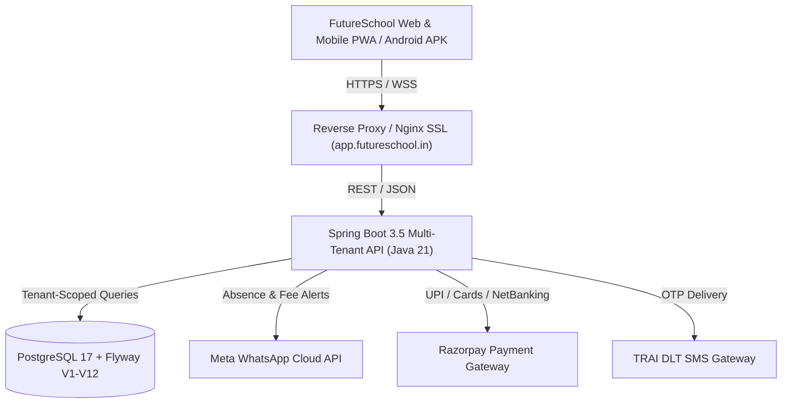

# Product Requirements Document (PRD)
## FutureSchool: Unified K-12 Institutional Management & School ERP System
**Document Version:** 2.0.0 | **Status:** Approved for Production | **Owner:** Ashish Vollala

---

## 1. Executive Summary & Vision

### 1.1 Problem Statement
Modern Indian K-12 schools, particularly state-board (Telangana SCERT / AP SCERT) and CBSE institutions, operate in severe operational fragmentation:
- **Parent Anxiety:** Parents juggle 10+ unstructured WhatsApp groups, miss bus arrival notices at 7:45 AM, lose physical homework diaries, and queue up at school counters for manual fee receipts.
- **Teacher Burden:** Teachers spend up to 45 minutes every morning on paper attendance, manual register collation, and redundant marks computation across composite subjects (e.g., Physical Science + Biological Science).
- **Principal & Bursar Blind Spots:** School leadership lacks instant, real-time insight into fee collections, student absenteeism, UDISE+ compliance readiness, and teacher workload across sections.

### 1.2 Product Vision
**FutureSchool** (*"One Connected School Community"*) is a unified, cloud-native, offline-capable institutional management platform. It consolidates Parent, Teacher, Principal, and School Owner interactions into dedicated, high-speed mobile PWAs and web dashboards with zero login friction (4-digit MPIN), native Telugu/English bilingual support, automated statutory compliance (UDISE+ / SCERT), and instant digital UPI fee settlements.

---

## 2. Target User Personas & Workspaces

| Persona | Primary Needs & Pain Points | Primary Interface | Key Capabilities |
| :--- | :--- | :--- | :--- |
| **Parent / Guardian** | Morning bus panic, homework tracking, instant fee receipts, Telugu language support, multi-child tracking. | **Parent Mobile App (PWA/APK)** | 1-Tap 4-digit MPIN login, multi-ward switcher, fee pay via UPI/Razorpay, Telangana SCERT report cards, bus GPS. |
| **Class & Subject Teacher** | Rapid morning attendance (< 60s), homework broadcasting, marks entry, leave application. | **Staff Mobile App & Web** | Fast period attendance, subject marks workflow, AI quiz/question generator, timetable view. |
| **School Principal** | Institutional governance, hall ticket release, marks verification, fee defaulter tracking, UDISE+ export. | **Principal Leadership Console (Web)** | 3-tier marks verification approval, fee-linked hall ticket release, staff attendance audit, teacher substitution. |
| **School Bursar / Admin** | Fee structure setup, term instalments, payment reconciliation, student admissions, school settings. | **Admin Operations Hub (Web)** | Custom fee plans, manual fee receipt counter, DLT SMS configuration, user lifecycle. |
| **School Group Owner** | Cross-branch financial health, aggregate admissions, comparative staff & student KPIs. | **Owner Multi-School Dashboard (Web)** | Multi-school consolidated fee revenues, cross-campus attendance benchmarks, branch switching. |

---

## 3. Product Architecture & Scope

### 3.1 Core Product Modules

#### Module 1: Multi-Tenancy & School Onboarding
- Independent data isolation per school via `school_id` foreign keys and Hibernate tenant filtering.
- Fast onboarding via student CSV bulk import, auto-generation of initial parent/teacher credentials.
- School configuration: academic year, grading scheme (Telangana SCERT, CBSE, ICSE), term fee schedules.

#### Module 2: Authentication & Trusted Device Security
- **Dual Flow:**
  - *Staff/Principal:* Mobile + OTP + Password + optional Microsoft/Google SSO.
  - *Parents:* Mobile + OTP (first time) $\rightarrow$ 4-digit MPIN setup $\rightarrow$ Trusted Device token storage.
- Zero-OTP delay on subsequent parent app launches; fingerprint/biometric pass-through where supported.

#### Module 3: Academics & SCERT Telangana Report Cards
- Full 8-examination cycle: FA-1, FA-2, SA-1, FA-3, FA-4, SA-2, Pre-Final, Annual.
- Specialized handling of composite subjects:
  - *General Science (100 Marks)* = *Physical Science (50 Marks: 10 Internal + 40 External)* + *Biological Science (50 Marks: 10 Internal + 40 External)*.
- Swipeable report cards with grade distribution (A1, A2, B1, B2, C1, C2, D, E), attendance %, and teacher remarks.

#### Module 4: Fee Tracking & Automated Examination Hall Ticket Lock
- Term 1, Term 2, Term 3, Term 4 instalment schedule with real-time balance tracking.
- **Automated Hall Ticket Lock:** If any term fee balance is pending (> ₹0), the examination admit card / hall ticket is strictly withheld from student and parent download.
- **Offline Counter Clearance:** Parents settle dues at the school fee counter or via school's direct campus bank account QR; school accountants record cash/bank receipts in the Fee Desk in under 30 seconds.
- **Instant Auto-Unlock:** The moment the office records the payment, the student's fee clearance switches to `CLEARED` and the Hall Ticket automatically unlocks for printing.
- Eliminates 2% payment gateway commissions, gateway merchant KYC delays, and payment failure disputes.

#### Module 5: Automated Attendance & WhatsApp Alerts
- Class teacher marks attendance in under 60 seconds with 1-tap "Mark All Present" toggle.
- **Absence Hold-off Engine:** Automated 10-minute hold buffer to allow teachers to correct accidental marks before triggering Meta WhatsApp Cloud API alert to parent.
- Daily attendance analytics for principal (percentage trends, chronic absentees).

#### Module 6: Digital Communication & Grievance Desk
- School notices with audience targeting (Entire School, Specific Grade, Section-only).
- Digital consent slips for excursions, sports events, and medical checkups with digital parent sign-off.
- Confidential parent helpdesk / grievance ticket escalation directly to principal.

#### Module 7: Transport & GPS Bus Tracking
- Live bus location beacon streaming to parents on active pickup/drop routes.
- Driver contact card, emergency SOS button, route stoppage timetable, and arrival delay notifications.

#### Module 8: UDISE+ Statutory Export & Governance
- One-click student demographic and academic data export formatted to statutory Ministry of Education UDISE+ requirements.
- Hall ticket clearance gating based on administrative tuition clearance thresholds.

---

## 4. Success Metrics & Key Performance Indicators (KPIs)

1. **Morning App Open Speed:** Parent app cold start to dashboard $< 1.2$ seconds with MPIN.
2. **Attendance Turnaround:** $100\%$ class attendance submitted before 09:15 AM across all sections.
3. **Fee Collection Acceleration:** Average fee collection cycle reduced from 28 days to 9 days via in-app UPI reminders.
4. **Parent Retention:** Weekly active usage $> 85\%$ among enrolled student families.
5. **Zero Data Leakage:** $100\%$ multi-tenant query isolation verified by automated CI security contract tests.
