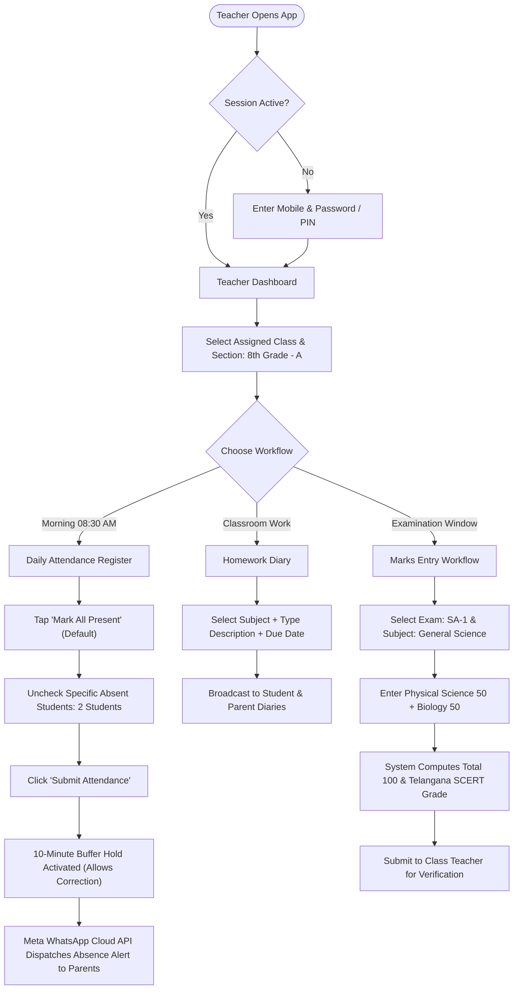
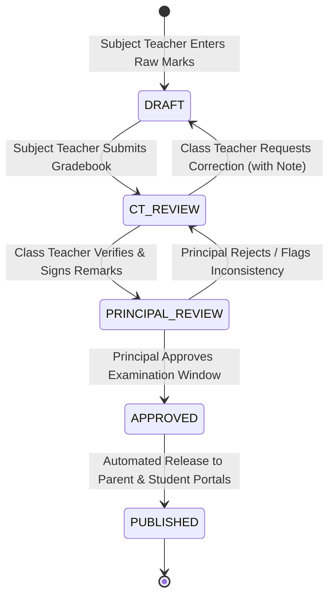
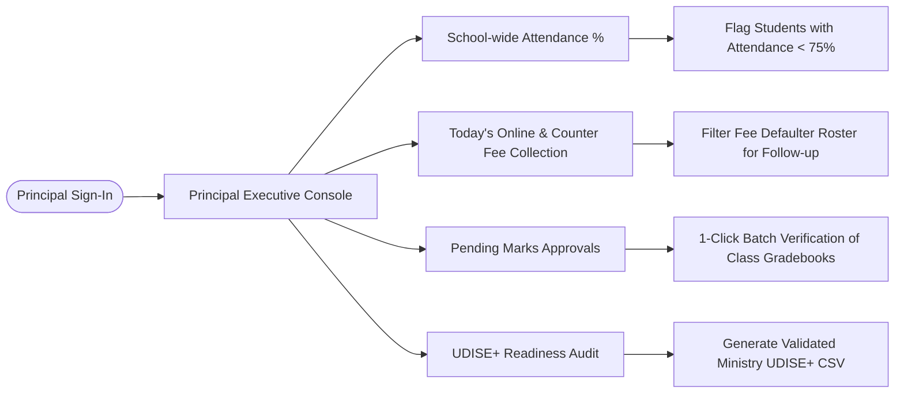
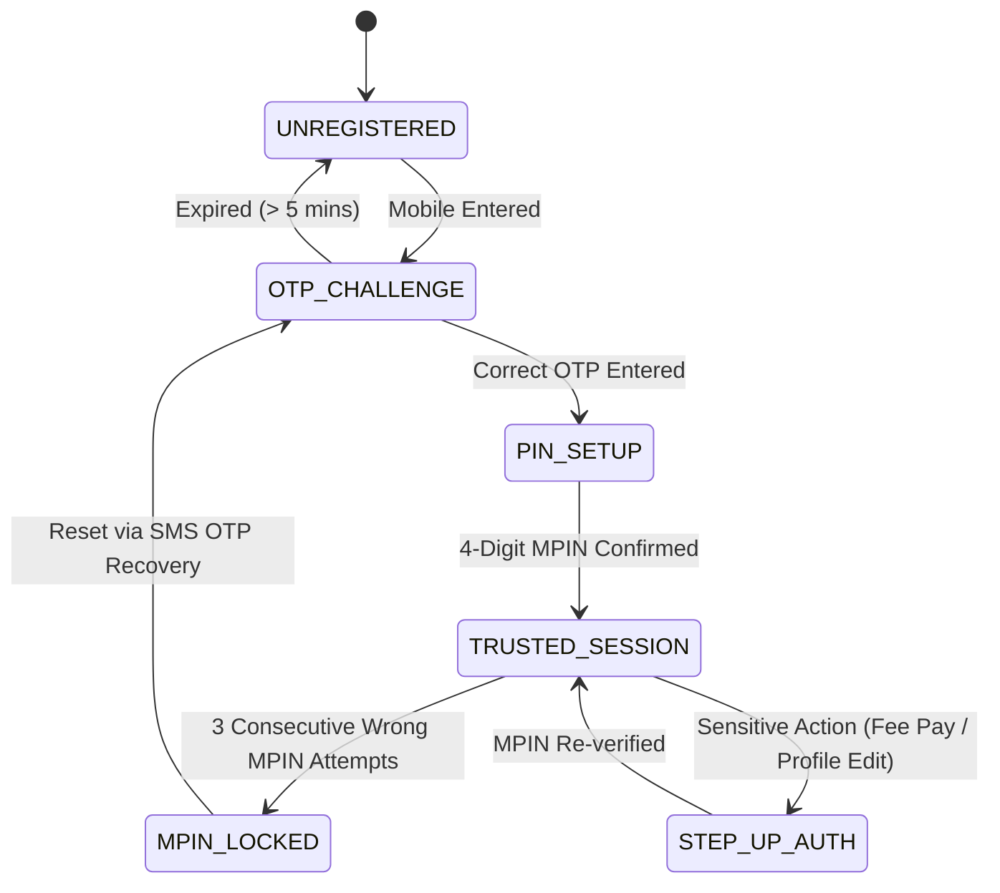

# App Flow Document (User Journeys & State Transitions)
## FutureSchool: Complete User Experience & System Flows
**Document Version:** 2.0.0 | **Owner:** UX & Product Architecture / Ashish Vollala

---

## 1. Parent App User Flow

```mermaid
sequenceDiagram
    autonumber
    actor Parent as Parent / Guardian
    participant App as Parent PWA / Mobile App
    participant Auth as Auth & Session Service
    participant SMS as DLT SMS Gateway
    participant Core as Backend Core API
    participant PG as Razorpay / UPI

    Note over Parent,App: Phase 1: First-Time Onboarding
    Parent->>App: Opens App & Enters 10-digit Mobile Number
    App->>Auth: POST /api/auth/otp/request
    Auth->>SMS: Deliver 6-digit OTP via DLT Template
    SMS-->>Parent: SMS Received ("Your FutureSchool OTP is...")
    Parent->>App: Inputs 6-digit OTP
    App->>Auth: POST /api/auth/otp/verify
    Auth-->>App: OTP Validated + Issues Temporary Setup Token
    Parent->>App: Creates 4-Digit MPIN (e.g. 1984) & Confirms
    App->>Auth: POST /api/auth/parent/pin/setup
    Auth-->>App: MPIN Hashed & Saved; Issues Long-lived Trusted Device JWT

    Note over Parent,App: Phase 2: Daily 1-Tap Access
    Parent->>App: Opens App Next Morning
    App-->>Parent: Displays 4-Digit MPIN Pad (Zero OTP Needed)
    Parent->>App: Enters MPIN (4 taps)
    App->>Auth: Verify Local/Remote MPIN Challenge
    Auth-->>App: Unlocks Session & Loads Dashboard (< 1.2s)

    Note over Parent,App: Phase 3: Term Fee Clearance via UPI
    Parent->>App: Taps "Fees" Tab -> Views Term 2 Balance (₹12,500)
    Parent->>App: Clicks "Pay via UPI"
    App->>Core: POST /api/payments/orders/create
    Core->>PG: Generate Razorpay UPI Order
    PG-->>App: UPI Intent / QR Gateway
    Parent->>PG: Approves Payment via PhonePe / GPay / Paytm
    PG->>Core: Webhook: payment.captured (HMAC SHA-256 Verified)
    Core->>Core: Allocate Fee Ledger & Generate PDF Receipt
    Core-->>App: Instant Payment Success Confirmation
    Parent->>App: Downloads Official PDF Fee Receipt with QR Code
```

---

## 2. Teacher Daily Classroom Flow



---

## 3. Academic 3-Tier Report Card Approval Workflow

To ensure total institutional integrity, student marks are never published directly to parents without strict multi-tier verification.



---

## 4. Principal Leadership & Emergency Governance Flow



---

## 5. Security & Authentication State Machine


