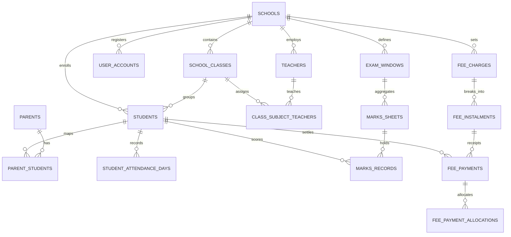

# Backend Database Schema Document
## FutureSchool: Relational Data Model, Constraints & Multi-Tenant Architecture
**Database:** PostgreSQL 17.x | **Migrations:** Flyway V1–V12 | **Owner:** Backend Lead / Ashish Vollala

---

## 1. Entity-Relationship Overview



---

## 2. Core Relational Tables & Data Dictionary

### 2.1 Multi-Tenant Root & Identity

#### `schools`
Stores the fundamental institution tenant metadata.
| Column | Type | Constraints | Description |
| :--- | :--- | :--- | :--- |
| `id` | `UUID` | `PRIMARY KEY` | Unique school identifier |
| `code` | `VARCHAR(32)` | `UNIQUE NOT NULL` | Unique code (e.g. `GMS-HYD`, `GVS-SEC`) |
| `name` | `VARCHAR(255)` | `NOT NULL` | Formal school legal name |
| `board_type` | `VARCHAR(32)` | `NOT NULL` | `TELANGANA_STATE`, `AP_STATE`, `CBSE`, `ICSE` |
| `address` | `TEXT` | `NULL` | Campus physical location |
| `created_at` | `TIMESTAMP WITH TIME ZONE` | `NOT NULL DEFAULT CURRENT_TIMESTAMP` | System creation timestamp |

#### `user_accounts`
Central authentication credentials table for all roles.
| Column | Type | Constraints | Description |
| :--- | :--- | :--- | :--- |
| `id` | `UUID` | `PRIMARY KEY` | User account identifier |
| `mobile` | `VARCHAR(15)` | `NOT NULL` | 10-digit Indian mobile number |
| `password_hash`| `VARCHAR(255)` | `NULL` | BCrypt hash for staff/principals |
| `mpin_hash` | `VARCHAR(255)` | `NULL` | BCrypt hash of 4-digit parent MPIN |
| `role` | `VARCHAR(32)` | `NOT NULL` | `ROLE_PARENT`, `ROLE_TEACHER`, `ROLE_PRINCIPAL`, `ROLE_ADMIN`, `ROLE_OWNER` |
| `is_active` | `BOOLEAN` | `NOT NULL DEFAULT TRUE`| Account access lock toggle |
| `created_at` | `TIMESTAMP WITH TIME ZONE` | `NOT NULL DEFAULT CURRENT_TIMESTAMP` | Account creation date |

#### `trusted_devices` (Flyway V7)
Tracks hardware device tokens for zero-OTP parent app sign-in.
| Column | Type | Constraints | Description |
| :--- | :--- | :--- | :--- |
| `id` | `UUID` | `PRIMARY KEY` | Device mapping ID |
| `user_id` | `UUID` | `REFERENCES user_accounts(id) ON DELETE CASCADE` | Associated parent account |
| `device_fingerprint` | `VARCHAR(255)` | `NOT NULL` | Hardware browser / app fingerprint hash |
| `device_name` | `VARCHAR(100)` | `NULL` | Human-readable name (e.g. "OnePlus 11R") |
| `last_used_at`| `TIMESTAMP WITH TIME ZONE` | `NOT NULL` | Last authentication timestamp |
| `expires_at` | `TIMESTAMP WITH TIME ZONE` | `NOT NULL` | Token expiry threshold (typically 90 days)|

---

### 2.2 Student & Academic Entities

#### `students`
| Column | Type | Constraints | Description |
| :--- | :--- | :--- | :--- |
| `id` | `UUID` | `PRIMARY KEY` | Unique student ID |
| `school_id` | `UUID` | `NOT NULL REFERENCES schools(id)` | Tenant identifier |
| `admission_number` | `VARCHAR(64)` | `NOT NULL` | School admission/scholar number |
| `roll_number` | `INTEGER` | `NOT NULL` | Class roll number |
| `full_name` | `VARCHAR(255)` | `NOT NULL` | Student official name |
| `class_id` | `UUID` | `NOT NULL REFERENCES school_classes(id)` | Current assigned grade & section |
| `pen_udise` | `VARCHAR(32)` | `NULL` | Permanent Education Number (UDISE+) |
| `gender` | `VARCHAR(16)` | `NOT NULL` | `MALE`, `FEMALE`, `OTHER` |
| `date_of_birth`| `DATE` | `NOT NULL` | Birth date for statutory records |

#### `parent_students`
Many-to-Many mapping table linking parents to one or more children across classes.
| Column | Type | Constraints | Description |
| :--- | :--- | :--- | :--- |
| `parent_id` | `UUID` | `NOT NULL REFERENCES user_accounts(id)` | Parent user reference |
| `student_id` | `UUID` | `NOT NULL REFERENCES students(id)` | Enrolled student reference |
| `relationship`| `VARCHAR(32)` | `NOT NULL DEFAULT 'FATHER'` | `FATHER`, `MOTHER`, `LEGAL_GUARDIAN` |
| `PRIMARY KEY` | `(parent_id, student_id)` | Compound unique key | Prevents duplicate mapping |

---

### 2.3 Attendance & WhatsApp Alerts

#### `student_attendance_days`
Daily attendance register records.
| Column | Type | Constraints | Description |
| :--- | :--- | :--- | :--- |
| `id` | `UUID` | `PRIMARY KEY` | Attendance record ID |
| `school_id` | `UUID` | `NOT NULL REFERENCES schools(id)` | Tenant isolation key |
| `student_id` | `UUID` | `NOT NULL REFERENCES students(id)` | Student reference |
| `attendance_date` | `DATE` | `NOT NULL` | Calendar date of register |
| `status` | `VARCHAR(16)` | `NOT NULL` | `PRESENT`, `ABSENT`, `HALF_DAY`, `ON_LEAVE` |
| `recorded_by` | `UUID` | `NOT NULL REFERENCES user_accounts(id)` | Teacher who submitted record |
| `recorded_at` | `TIMESTAMP WITH TIME ZONE` | `NOT NULL` | Exact timestamp of entry |

#### `parent_alerts` (Flyway V10)
Manages the 10-minute hold-off and dispatch to the Meta WhatsApp Cloud API.
| Column | Type | Constraints | Description |
| :--- | :--- | :--- | :--- |
| `id` | `UUID` | `PRIMARY KEY` | Alert transaction ID |
| `school_id` | `UUID` | `NOT NULL REFERENCES schools(id)` | Tenant reference |
| `student_id` | `UUID` | `NOT NULL REFERENCES students(id)` | Associated student |
| `alert_type` | `VARCHAR(32)` | `NOT NULL` | `STUDENT_ABSENT`, `FEE_DUE`, `EMERGENCY` |
| `dispatch_status` | `VARCHAR(24)` | `NOT NULL` | `HOLDING`, `DISPATCHED`, `CANCELLED`, `FAILED` |
| `hold_until` | `TIMESTAMP WITH TIME ZONE` | `NOT NULL` | Entry timestamp + 10 minutes |
| `meta_message_id` | `VARCHAR(128)` | `NULL` | WhatsApp Cloud API message UUID |

---

### 2.4 Examination & Telangana SCERT Composite Marks

#### `marks_records`
Stores individual student marks including composite subject breakdowns.
| Column | Type | Constraints | Description |
| :--- | :--- | :--- | :--- |
| `id` | `UUID` | `PRIMARY KEY` | Marks entry ID |
| `school_id` | `UUID` | `NOT NULL REFERENCES schools(id)` | Tenant reference |
| `sheet_id` | `UUID` | `NOT NULL REFERENCES marks_sheets(id)` | Parent gradebook sheet reference |
| `student_id` | `UUID` | `NOT NULL REFERENCES students(id)` | Scored student |
| `internal_marks`| `NUMERIC(5,2)` | `NOT NULL DEFAULT 0.00` | Formative/Internal score (e.g. out of 10 or 20)|
| `external_marks`| `NUMERIC(5,2)` | `NOT NULL DEFAULT 0.00` | Summative score (e.g. out of 40 or 80) |
| `total_marks` | `NUMERIC(5,2)` | `NOT NULL` | Sum of internal + external |
| `grade` | `VARCHAR(8)` | `NOT NULL` | Computed SCERT grade: `A1`, `A2`, `B1`, etc. |
| `component_name`| `VARCHAR(64)` | `NULL` | E.g. `Physical Science`, `Biology` |

---

### 2.5 Fee Ledger (staff-recorded collections)

> **Fee policy (current):** parents do not pay in the app. Fees are paid at the school fee counter or by the school's direct bank QR; finance staff record the collection in the Fee Desk (`POST /api/office/fees/cash`) and the system issues the receipt. Online gateway payments (Razorpay / UPI checkout) are **out of scope / deferred**; the backend denies `/api/parent/fees/orders/**` and `/api/payments/**`. See PRD Module 4.

#### `fee_payments`
Collections recorded by finance staff at the school counter, with the official receipt number. Never created by a parent action.
| Column | Type | Constraints | Description |
| :--- | :--- | :--- | :--- |
| `id` | `UUID` | `PRIMARY KEY` | Receipt unique ID |
| `school_id` | `UUID` | `NOT NULL REFERENCES schools(id)` | Tenant identifier |
| `student_id` | `UUID` | `NOT NULL REFERENCES students(id)` | Student account |
| `instalment_id`| `UUID` | `NOT NULL REFERENCES fee_instalments(id)`| Term reference (`Term 1`, `Term 2`, etc.) |
| `receipt_number`| `VARCHAR(64)` | `UNIQUE NOT NULL` | Formatted number (e.g. `REC-2026-08492`)|
| `amount_paid` | `NUMERIC(10,2)`| `NOT NULL` | Exact transaction currency in INR |
| `payment_mode` | `VARCHAR(32)` | `NOT NULL` | `CASH_AT_OFFICE` (counter cash / school bank QR recorded by the office). Online gateway modes are not used. |
| `transaction_ref`| `VARCHAR(128)`| `NULL` | Office reference / slip note (no gateway payment ID) |
| `payment_date` | `TIMESTAMP WITH TIME ZONE` | `NOT NULL` | Transaction confirmation timestamp |

---

## 3. Flyway Database Migrations Evolution (V1–V12)

```
V1__initial_schema.sql             -> Base tables: schools, users, classes, students
V2__school_id_multitenancy.sql     -> Added tenant school_id across all tables
V3__backfill_signin_mobiles.sql    -> Cleaned 10-digit mobile number constraints
V4__full_schema.sql                -> Complete relational schema hydration
V5__teacher_one_school.sql         -> Enforced teacher single-school association
V6__teacher_pin.sql                -> Teacher quick-access PIN support
V7__trusted_devices.sql            -> Trusted mobile device tokens for parents
V8__parent_pin.sql                 -> 4-digit parent MPIN hashing and verification
V9__microsoft_google_sign_in.sql   -> OAuth2 IdP links for principals & leadership
V10__parent_whatsapp_alerts.sql    -> Absence 10-min hold buffer and WhatsApp dispatch
V11__razorpay_orders.sql           -> Legacy: Razorpay order tables (unused; online payments are out of scope)
V12__bus_tracking.sql              -> GPS routes, live bus beacons, and driver contacts
```
