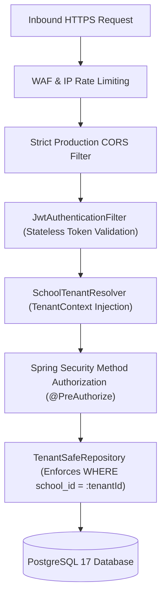

# Security & Access Control Architecture Document
## FutureSchool: Multi-Tenant Data Isolation, RBAC & Hardening Specifications
**Document Version:** 2.0.0 | **Compliance:** DPDP Act 2023 (India) | **Owner:** Security Officer / Ashish Vollala

---

## 1. Security Architecture Principles



---

## 2. Production Safety Guard: `ProductionSafetyCheck.java`

To eliminate configuration human error, FutureSchool implements an uncompromising startup gatekeeper. When started with `--spring.profiles.active=prod`, the application will **immediately abort boot** if any of the following conditions fail:

```java
// ProductionSafetyCheck verification rules:
1. app.otp.dev-reveal == false           // Never echo OTPs in API responses
2. app.seed.demo-data == false           // Never seed mock accounts with default passwords
3. app.otp.sms.provider == "http"        // Must point to active TRAI DLT gateway
4. app.otp.email.provider == "smtp"      // Must configure real SMTP credentials
5. jwt.secret != DEV_SECRET && len >= 64 // Must use cryptographically strong 64+ char secret
6. app.cors.allowed-origins !contains "localhost" // Must strictly bind to official school domain
7. spring.jpa.hibernate.ddl-auto == "validate"    // Hibernate prohibited from modifying schema
```

---

## 3. Multi-Tenant Data Isolation Standard

Data leakage between competing educational institutions is an existential risk. FutureSchool enforces multi-tenancy at three distinct architectural levels:

### Level 1: Foreign Key Mandate
Every database entity (except global system metadata) must define:
```sql
school_id UUID NOT NULL REFERENCES schools(id) ON DELETE RESTRICT
```

### Level 2: ThreadLocal Tenant Context
Every incoming HTTP request resolves the school tenant from the validated JWT token:
```java
TenantContext.setCurrentTenant(extractedSchoolId);
```
`open-in-view` is set to `false` in `application.properties` to ensure transactions close immediately per request, preventing cross-tenant connection re-use.

### Level 3: TenantSafeRepository Enforcement
All JPA repositories inherit from `TenantSafeRepository<T, ID>`, which automatically appends `WHERE e.school_id = :currentTenantId` to every select, update, and delete query. Cross-tenant queries are blocked at the repository level.

---

## 4. Role-Based Access Control (RBAC) Matrix

| Resource / Endpoint | `ROLE_PARENT` | `ROLE_TEACHER` | `ROLE_PRINCIPAL` | `ROLE_ADMIN` | `ROLE_OWNER` |
| :--- | :---: | :---: | :---: | :---: | :---: |
| **View Own Ward Marks & Attendance** | ✅ | ❌ | ✅ | ✅ | ❌ |
| **Mark Class Attendance** | ❌ | ✅ | ✅ | ❌ | ❌ |
| **Enter Subject Raw Marks** | ❌ | ✅ | ❌ | ❌ | ❌ |
| **Verify Gradebook (Class Teacher)** | ❌ | ✅ | ❌ | ❌ | ❌ |
| **Final Approve & Publish Report Cards** | ❌ | ❌ | ✅ | ❌ | ❌ |
| **Pay Term Fees Online** (out of scope: denied for every role) | ❌ | ❌ | ❌ | ❌ | ❌ |
| **View Own Ward Dues & Recorded Receipts** | ✅ | ❌ | ❌ | ✅ | ❌ |
| **Create Custom Fee Structure** | ❌ | ❌ | ❌ | ✅ | ❌ |
| **Record Counter Fee Collection & Issue Receipt** (Admin with `FINANCE`) | ❌ | ❌ | ❌ | ✅ | ❌ |
| **Release Hall Tickets** (Class Teacher of the class, after server-computed fee clearance; Principal only by audited emergency override) | ❌ | ✅ | ✅ | ❌ | ❌ |
| **Export Statutory UDISE+ CSV** | ❌ | ❌ | ✅ | ✅ | ❌ |
| **Cross-School Consolidated Analytics** | ❌ | ❌ | ❌ | ❌ | ✅ |

---

## 5. Parent MPIN & Hardware Device Trust Policy

1. **Hashing Standard:** 4-digit numeric MPINs are hashed using **BCrypt** with an algorithmic work factor of **12** (`$2a$12$...`) before persistent storage in `user_accounts.mpin_hash`.
2. **Brute-Force Lockout:**
   - Maximum allowable failed attempts: **3 consecutive attempts**.
   - Upon the 3rd failed attempt, the account enters `MPIN_LOCKED` status for **15 minutes**.
   - Immediate unlock requires completing a full SMS OTP verification challenge.
3. **Step-Up Authentication:**
   - Sensitive parent actions (such as issuing a pickup pass or changing the PIN) trigger a step-up re-prompt even within an active session. There is no in-app fee payment to confirm.

---

## 6. Financial & PII Data Protection (PCI-DSS & DPDP Act 2023)

1. **Zero Card/Bank Credential Storage:** FutureSchool servers **never touch, process, or store** credit/debit card numbers, CVVs, UPI PINs, netbanking passwords, or VPA handles. There is no in-app payment flow: fees are paid at the school counter and recorded by finance staff, so no card, UPI or bank data ever reaches the app.
2. **Student PII Masking:** Permanent Education Numbers (PEN UDISE+) and student birth certificates stored in cloud object storage are encrypted with server-side AES-256 keys and accessible only via short-lived pre-signed URLs (5-minute TTL).
