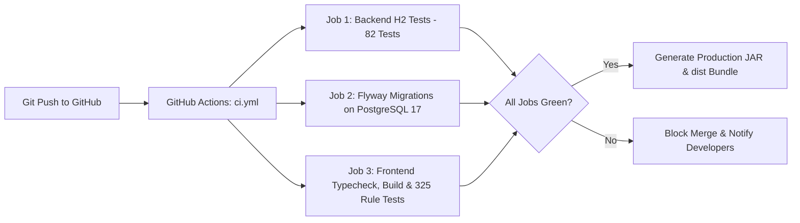

# Deployment & Testing Architecture Document
## FutureSchool: CI/CD Pipeline, Automated Testing Suite & Production Runbook
**Document Version:** 2.0.0 | **CI Tool:** GitHub Actions | **Owner:** DevOps & QA Lead / Ashish Vollala

---

## 1. Continuous Integration & Pipeline Architecture



### 1.1 CI Pipeline Stages (`.github/workflows/ci.yml`)
1. **`backend` Job:** Executes `./mvnw -B -ntp clean test` on Ubuntu with OpenJDK 21. Runs 82 automated tests verifying multi-school tenant isolation, JWT authentication, 4-digit MPIN hashing, Razorpay order flows, and SCERT Telangana marks calculations.
2. **`backend-postgres` Job:** Boots ephemeral PostgreSQL 17 container, executes Flyway migrations V2 through V12 on an empty database, and validates schema matches entity annotations (`ddl-auto=validate`).
3. **`frontend` Job:** Installs dependencies on Node.js 22, executes `npm run typecheck`, compiles production bundle via `npm run build`, and validates 325 frontend service rule tests (`npm run test:services`).

---

## 2. Automated Test Suite Breakdown

### 2.1 Backend Test Matrix (82 Spring Boot Tests)
| Test Class | Focus & Verification |
| :--- | :--- |
| `MultiSchoolIsolationTest.java` | Confirms school A can never query or mutate school B records. |
| `SignInFlowTest.java` | Full OTP $\rightarrow$ MPIN setup $\rightarrow$ Trusted Device token issuance. |
| `ParentPinTest.java` | Verifies 3-strike brute force lockout and BCrypt work factor 12. |
| `ParentDataTest.java` | Parents cannot create payment orders (403); staff-recorded counter cash updates balances and issues a receipt the parent can see. |
| `TeachingFlowTest.java` | Daily attendance submission and period-wise register management. |
| `BoardProfileTest.java` | Telangana SCERT General Science composite marks calculation (Phy 50 + Bio 50). |
| `AlertFlowTest.java` | 10-minute hold-off queue and cancellation on attendance correction. |
| `UdiseExportTest.java` | Ministry of Education UDISE+ CSV format and demographic validation. |

### 2.2 Frontend Service Test Matrix (325 Rule Checks)
- Executed via `node tests/services/run.mjs`.
- Verifies offline localStorage hydration, Telugu language string presence, fee balance calculations, and route protection guards.

---

## 3. Production Deployment Runbook (Step-by-Step)

### Step 1: Server Setup (Ubuntu 22.04 LTS)
```bash
# Update OS and install Java 21 + PostgreSQL 17
sudo apt update && sudo apt upgrade -y
sudo apt install -y openjdk-21-jdk postgresql-17 nginx certbot python3-certbot-nginx

# Create PostgreSQL database and non-root user
sudo -u postgres psql -c "CREATE USER futureschool_prod WITH PASSWORD 'STRONG_DB_PASSWORD';"
sudo -u postgres psql -c "CREATE DATABASE futureschool_prod OWNER futureschool_prod;"
sudo -u postgres psql -c "GRANT ALL PRIVILEGES ON DATABASE futureschool_prod TO futureschool_prod;"
```

### Step 2: Configure System Environment Variables
Edit `/etc/environment` or systemd service file:
```bash
DB_URL="jdbc:postgresql://localhost:5432/futureschool_prod"
DB_USERNAME="futureschool_prod"
DB_PASSWORD="STRONG_DB_PASSWORD"
JWT_SECRET="<64+_CHAR_RANDOM_HEX_STRING>"
APP_ORIGIN="https://app.futureschool.in"
SMS_GATEWAY_URL="https://control.msg91.com/api/v5/flow"
SMS_GATEWAY_KEY="<YOUR_MSG91_AUTH_KEY>"
SMS_GATEWAY_BODY='{"template_id":"<DLT_ID>","recipients":[{"mobiles":"91{{mobile}}","otp":"{{code}}"}]}'
```

### Step 3: Deploy Backend as Systemd Service
Create `/etc/systemd/system/futureschool.service`:
```ini
[Unit]
Description=FutureSchool Spring Boot Production API
After=syslog.target network.target postgresql.service

[Service]
User=ubuntu
WorkingDirectory=/var/www/futureschool/backend
ExecStart=/usr/bin/java -Xms1024m -Xmx2048m -jar /var/www/futureschool/backend/backend-0.0.1-SNAPSHOT.jar --spring.profiles.active=prod
SuccessExitStatus=143
Restart=always
RestartSec=10

[Install]
WantedBy=multi-user.target
```
Enable and start:
```bash
sudo systemctl daemon-reload
sudo systemctl enable futureschool
sudo systemctl start futureschool
```

### Step 4: Build and Deploy Frontend
```bash
cd /var/www/futureschool/Frontend
# Create production environment config
echo "VITE_BACKEND=api" > .env.production
echo "VITE_API_BASE_URL=https://api.futureschool.in" >> .env.production

# Build optimized production bundle
npm ci --no-audit
npm run build
# Output bundle is located at /var/www/futureschool/Frontend/dist
```

### Step 5: Nginx Reverse Proxy & SSL Configuration
Create `/etc/nginx/sites-available/futureschool`:
```nginx
# Frontend PWA (app.futureschool.in)
server {
    server_name app.futureschool.in;
    root /var/www/futureschool/Frontend/dist;
    index index.html;

    location / {
        try_files $uri $uri/ /index.html;
    }

    location ~* \.(js|css|png|jpg|jpeg|gif|ico|svg|woff2)$ {
        expires 1y;
        add_header Cache-Control "public, immutable";
    }
}

# Backend REST API (api.futureschool.in)
server {
    server_name api.futureschool.in;

    location / {
        proxy_pass http://127.0.0.1:5000;
        proxy_set_header Host $host;
        proxy_set_header X-Real-IP $remote_addr;
        proxy_set_header X-Forwarded-For $proxy_add_x_forwarded_for;
        proxy_set_header X-Forwarded-Proto $scheme;
    }
}
```
Issue Let's Encrypt certificates:
```bash
sudo ln -s /etc/nginx/sites-available/futureschool /etc/nginx/sites-enabled/
sudo nginx -t && sudo systemctl reload nginx
sudo certbot --nginx -d app.futureschool.in -d api.futureschool.in
```

---

## 4. Post-Deployment Smoke Test Checklist

Execute these 5 critical tests immediately following any production release:
1. **Health Check:** `curl -I https://api.futureschool.in/actuator/health` $\rightarrow$ Expect `200 OK`.
2. **Parent Login Flow:** Log in via test parent mobile + real SMS OTP $\rightarrow$ Set MPIN $\rightarrow$ Unlock dashboard.
3. **Report Card Rendering:** Verify Class 8 General Science renders Physical Science (50) and Biology (50) correctly.
4. **Fee Counter Collection:** Record a test collection in the Admin Fee Desk $\rightarrow$ verify the receipt number and the parent's updated balance and receipt history. (Online gateway payments are out of scope; there is no webhook to test.)
5. **Attendance Alert Buffer:** Mark test student absent $\rightarrow$ Verify alert stays in `HOLDING` status for 10 minutes.

---

## 5. Rollback & Disaster Recovery Procedures

### 5.1 Immediate Application Rollback (Blue/Green JAR switch)
```bash
# Revert to previous verified build artifact in under 30 seconds:
sudo cp /var/www/futureschool/backend/backend-0.0.1-SNAPSHOT.jar.bak /var/www/futureschool/backend/backend-0.0.1-SNAPSHOT.jar
sudo systemctl restart futureschool
```

### 5.2 Database Disaster Recovery
```bash
# Restore from latest daily automated snapshot:
sudo -u postgres dropdb futureschool_prod
sudo -u postgres createdb -O futureschool_prod futureschool_prod
sudo -u postgres psql futureschool_prod < /var/backups/futureschool/db_backup_latest.sql
```
